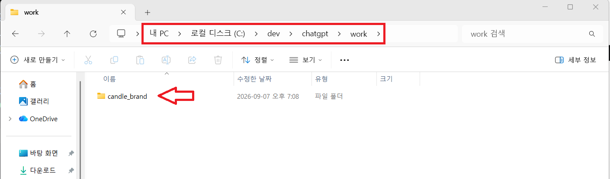
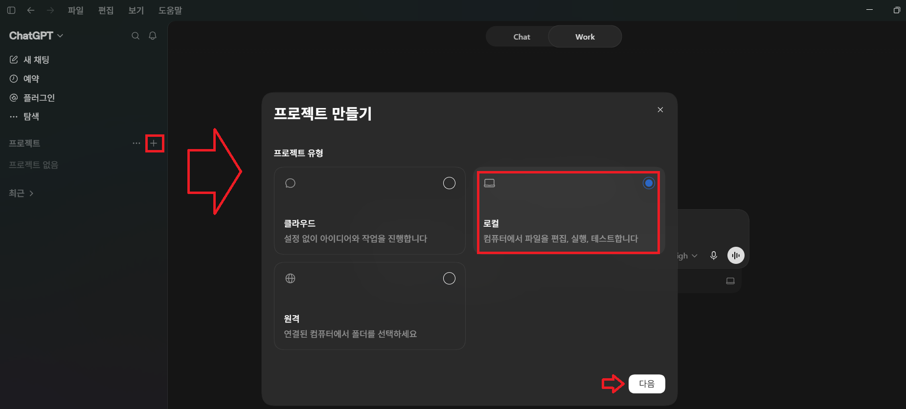
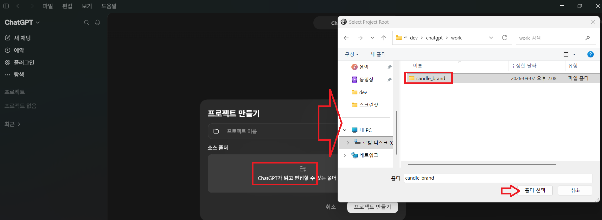
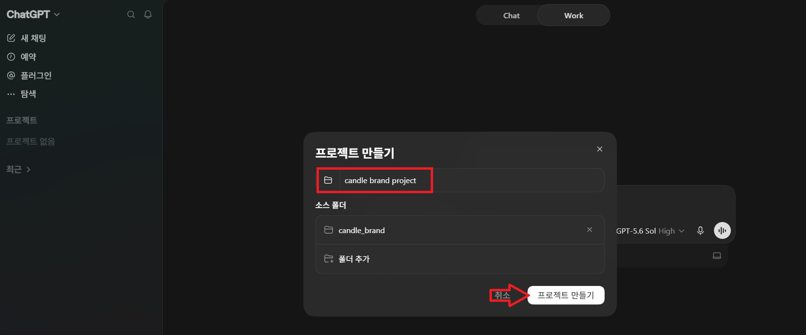
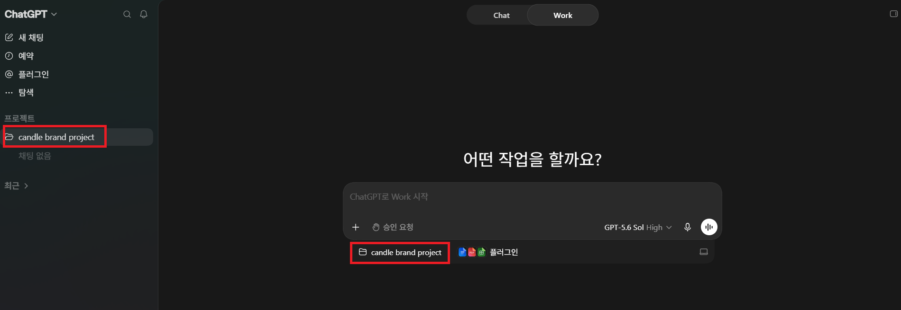

# [참고 영상 - 챗지피티 워크 완벽가이드 | 영상 하나로 끝내세요.](https://www.youtube.com/watch?v=biZsmM5kEcA)

---
### 단계1: 프로젝트 폴더 생성 
> work에서 사용할 프로젝트 폴더 생성하기 

---
### 단계2: work에 프로젝트 폴더 적용하기  

---
> 프로젝트 폴더 적용하기

---
> 프로젝트명은 가능하면 영어로 작성 

---
> 결과 확인 

