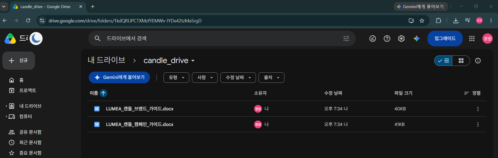
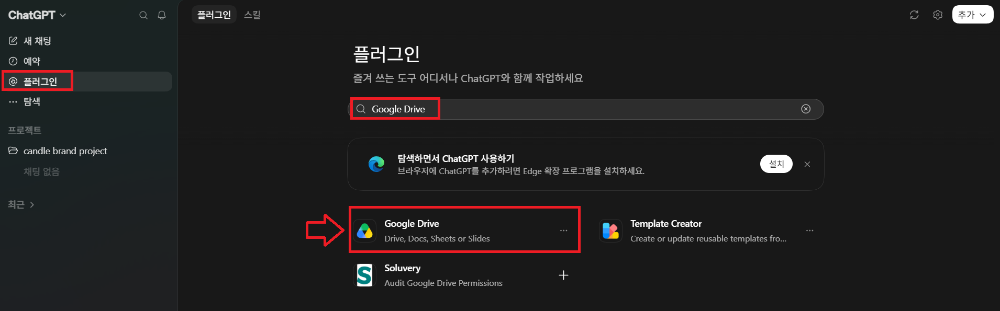
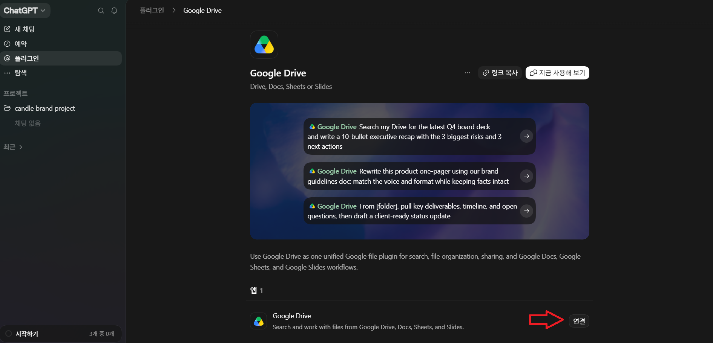
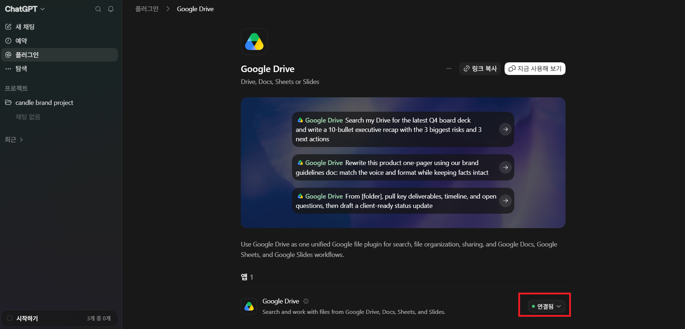
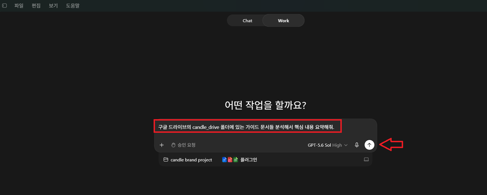
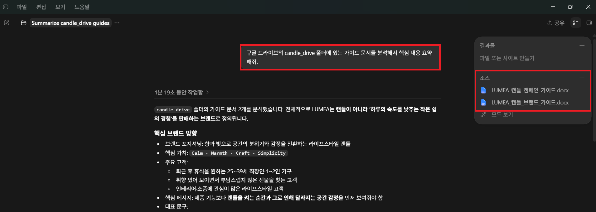
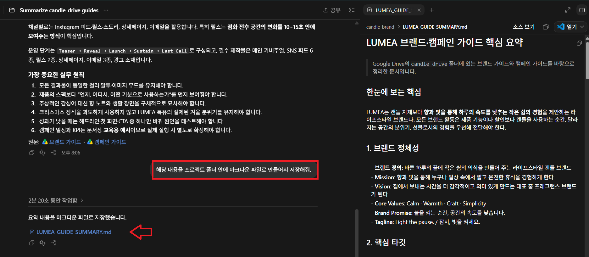
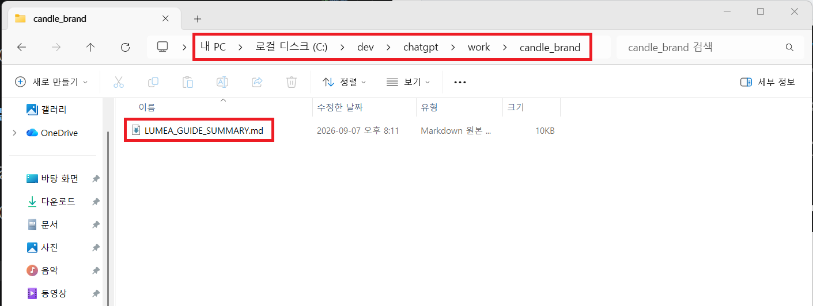

# [플러그인(Plugin) 이란?](https://help.openai.com/ko-kr/articles/20001256-plugins-in-chatgpt-and-codex?utm_source=chatgpt.com)
> 쉽게 말하면 `ChatGPT Work의 플러그인(Plugin)`은 ChatGPT가 외부 서비스나 특정 업무 기능을 사용할 수 있게 해주는 ‘기능 패키지’입니다.

---
**Plugin** = `Skills` + `Apps` + `App Templates`
- `Skill`: 특정 업무를 어떻게 처리해야 하는지 알려주는 지침/워크플로
- `App`: Google Drive, Slack, Gmail 같은 외부 서비스와 실제로 연결
- `App Template`: 조직에서 필요한 앱 연결을 구성하기 위한 템플릿

예를 들어 ChatGPT Work에서 Google Drive 관련 플러그인을 연결했다고 생각하면,
> "내 Drive에서 지난주 프로젝트 보고서를 찾아서 요약하고, 그 내용을 기반으로 발표자료 만들어줘."

같은 요청을 할 수 있습니다. ChatGPT Work가 Drive에서 자료 검색 → 내용 확인 → 분석 → 문서/슬라이드 생성처럼 여러 단계를 이어서 수행하는 구조입니다.

---
### 단계1: Google Drive에 가이드 문서 생성 
> docs 폴더에 있는 가이드 문서들을 이용해서 Google Drive에 업로드 



---
### 단계2: 플러그인을 통해 연결하기 



---


---


---
### 단계3: Google Drive에 있는 문서 분석 요청 
```txt
구글 드라이브의 candle_drive 폴더에 있는 가이드 문서들 분석해서 핵심 내용 요약해줘.
```


---
> 정확하게 구글 드라이브의 candle_drive 폴더에 있는 가이드 문서들을 확인한 후 내용 요약한 것을 확인할 수 있음 



---
### 단계4: 분석 파일 생성  
```txt
해당 내용을 프로젝트 폴더 안에 마크다운 파일로 만들어서 저장해줘.
```


---
> 프로젝트 폴더에 새로 생성된 파일 확인 




