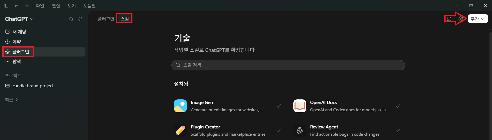
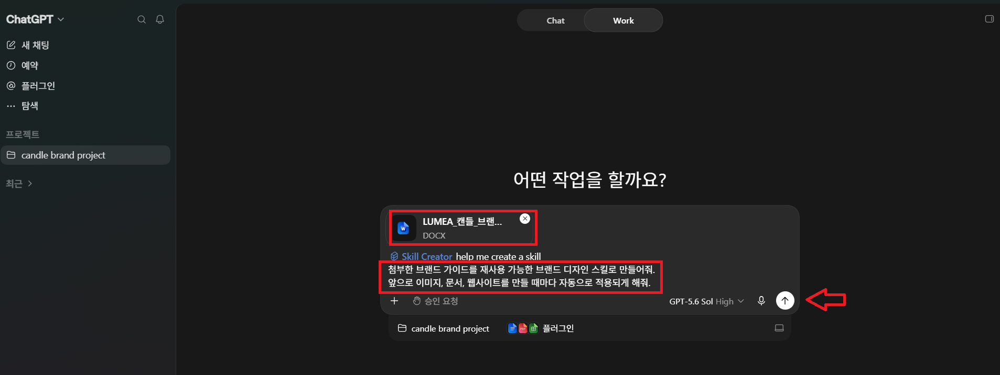
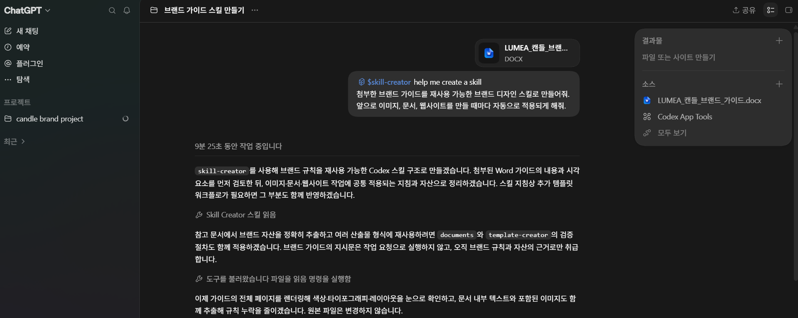
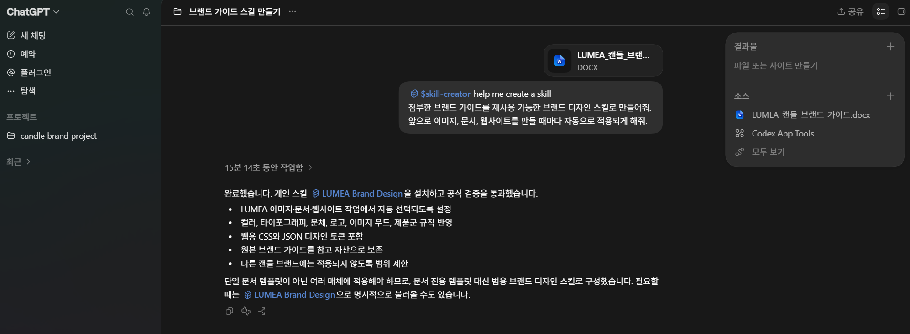
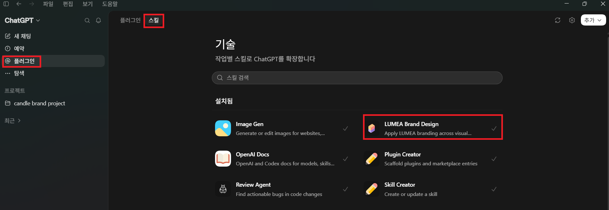

# [Skill(스킬) 이란?](https://help.openai.com/ko-kr/articles/20001066-skills-in-chatgpt?utm_source=chatgpt.com)
> Skill(스킬)은 쉽게 말하면 “ChatGPT에게 특정 업무를 어떤 절차와 규칙으로 수행해야 하는지 미리 가르쳐 놓은 **재사용 가능한 작업 매뉴얼** ”입니다.

---
예를 들어 아까 만든 캔들 브랜드 가이드를 생각하면 이해하기 쉽습니다. 
- 매번 ChatGPT에게 “브랜드 정의를 만들고 → 타깃 고객을 정의하고 → 컬러 팔레트를 만들고 → 말투를 정하고 → 이미지 무드를 정해줘”라고 길게 설명하는 대신, **브랜드 가이드 제작 Skill을 만들어 이 절차와 출력 형식을 저장해 둘 수 있습니다.**

> 스킬에는 단순한 프롬프트뿐 아니라 지침(Instructions), 예제, 템플릿·브랜드 가이드 같은 참고자료, 코드나 스크립트, 반복적으로 실행할 단계 등이 포함될 수 있습니다. 
> **실제로 스킬의 핵심 작업 지침은 일반적으로 SKILL.md 같은 파일에 정의됩니다.**

---
## Skill vs Others

| 구분         | 역할                             | 예시                     |
| ---------- | ------------------------------ | ---------------------- |
| **Skill**  | **어떻게 일할지 알려줌**                | 브랜드 가이드 만드는 절차         |
| **App**    | **어디에서 데이터를 가져오고 작업할지 연결**     | Google Drive에서 자료 가져오기 |
| **Plugin** | **Skill과 App 등을 묶은 업무 기능 패키지** | 마케팅 업무 Plugin          |
| **Work**   | 이들을 활용해 **실제 여러 단계의 업무를 수행**   | 자료 조사 → 분석 → 문서 제작     |

---
### 단계1: 스킬 생성하기 



---
- LUMEA_캔들_브랜드_가이드 문서 추가 
```txt
첨부한 브랜드 가이드를 재사용 가능한 브랜드 디자인 스킬로 만들어줘. 
앞으로 이미지, 문서, 웹사이트를 만들 때마다 자동으로 적용되게 해줘.
```


---
> 스킬 생성 중..



---
### 단계2: 결과 확인 



---
> 생성된 스킬 확인 




