# (예시) 캠페인 방향 정하고, 공식 컨셉 문서 만들기

---
### 단계1: 요청하기 
```txt
구글 드라이브 candle_drive 폴더의 캠페인 가이드를 열어서 전체를 읽어줘.
그리고 이번 런칭에서 밀 수 있는 캠페인 방향을 3개 뽑아줘.
각 방향마다 이렇게 정리해줘.
- 한 줄 메시지 
- 왜 우리 타깃한테 먹히는지 
- 이 방향으로 가면 이미지가 어떤 장면이 되는지 

그리고 3개 중에 1인 브랜드가 혼자 감당할 수 있으면서 가자 ㅇ승산 있는 걸 하나 골라주고, 이유도 말해줘.
```

---
> 생성된 스킬과 캠페인 가이드 문서 참고 확인 중..

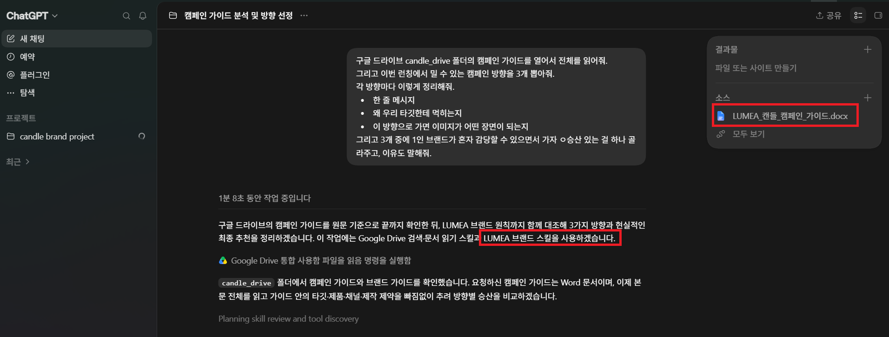

---
### 단계2: 답변 완료 후 공식 컨셉 문서 만들기
```txt
방금 정한 방향으로 캠페인 컨셉 정리 문서를 만들어줘.
브랜드 스킬을 적용해서 우리 톤에 맞게 써주고, 이미지 제작 방향과 랜딩 페이지에 들어갈 메시지까지 포함해줘.
완성되면 PDF 파일로 프로젝트 폴더에 저장해줘.
```
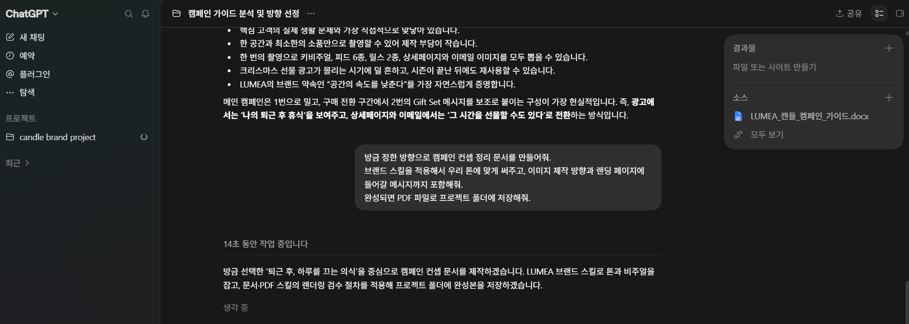

---
> 결과 확인 

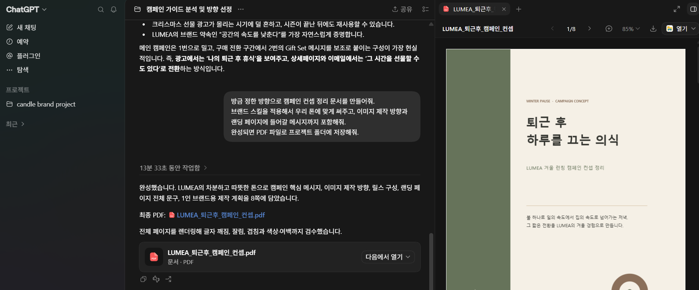

---
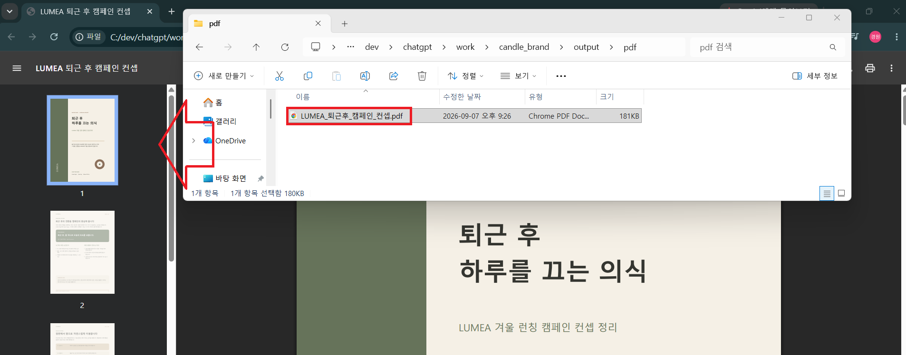

---
# (예시) 컨셉 문서로 이미지 만들기
> 공식 컨셉 문서를 참고해서 이미지 만들기 

---
### 단계1: 요청하기 
```txt
캠페인 컨셉 문서의 샷 리스트 4개를 그대로 이미지로 각각 만들어줘.
문서의 비주얼 룰을 지켜서 만들어줘.
완성된 이미지는 프로젝트 폴더에 저장해줘.
```
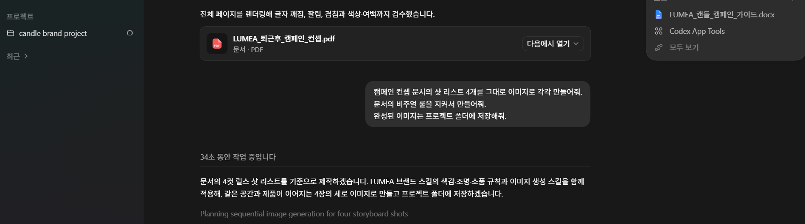

---
### 단계2: 결과 확인하기 

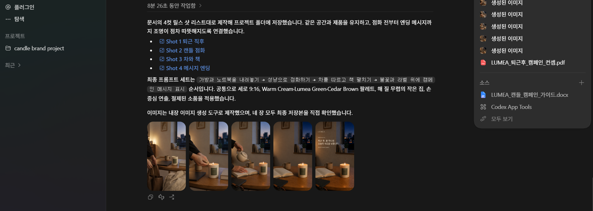

---
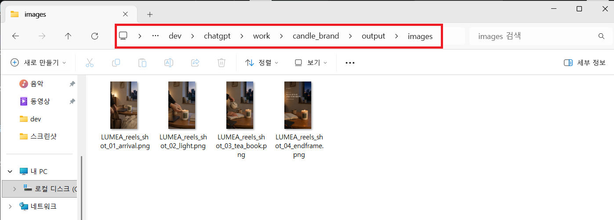

---
# (예시) 웹사이트 만들기 
> 공식 컨셉 문서와 생성된 이미지를 이용해서 웹사이트 만들기 

---
### 단계1: `@`를 입력 후 Site 선택 
> Site는 웹사이트를 생성할 때 사용하는 옵션 

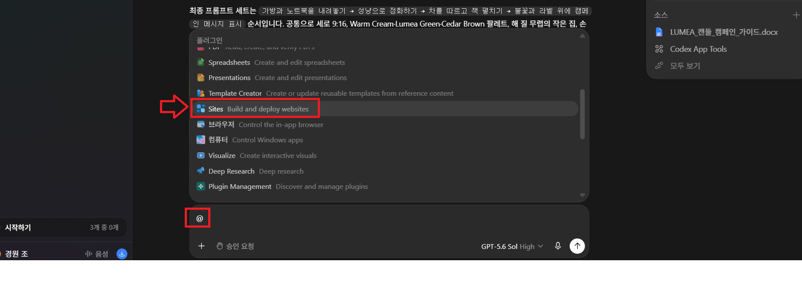

---
### 단계2: 요청하기 
```txt
캠페인 컨셉 문서의 랜딩 페이지 메시지를 그대로 사용해서 런칭 랜딩 사이트를 만들고 배포해줘.
사진은 아까 만든 이미지 4장을 리유즈 맵대로 배치해줘.
문서의 비주얼 룰과 브랜드 톤을 지켜서 만들어줘.
```
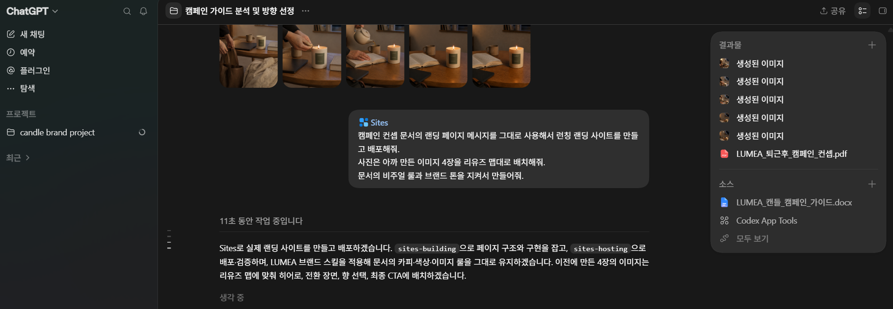

---
### 단계3: 결과 확인하기 
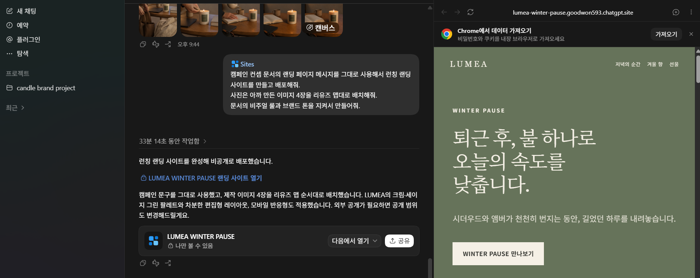

---
# (예시) 웹사이트 접속 및 수정하기 

---
### 단계1: 웹사이트 접속하기 
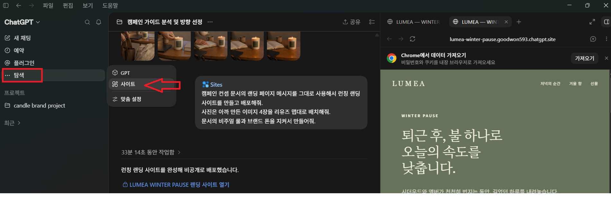

---
> 사이트 > 설정 

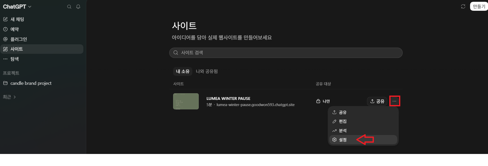

---
> 누구나 접속 가능하게 설정 

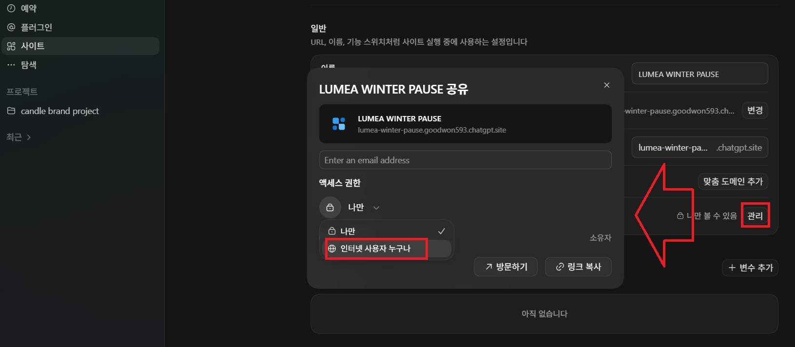

---
> 수정된 내용 적용(개시)

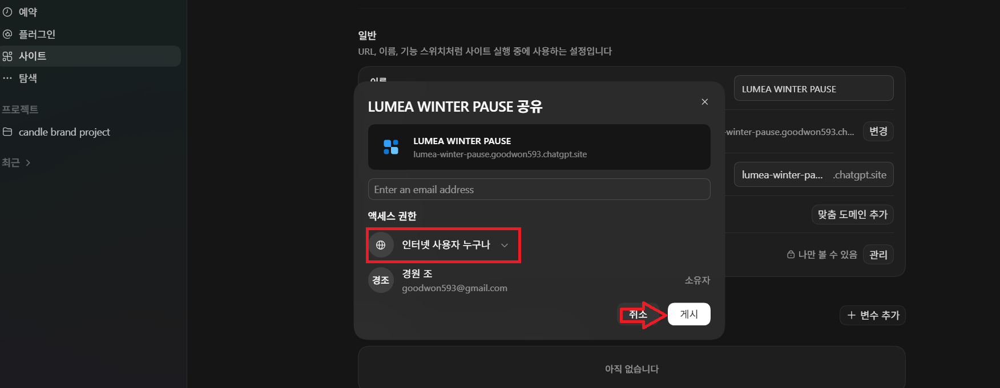

---
> 접속할 URL 복사하기  

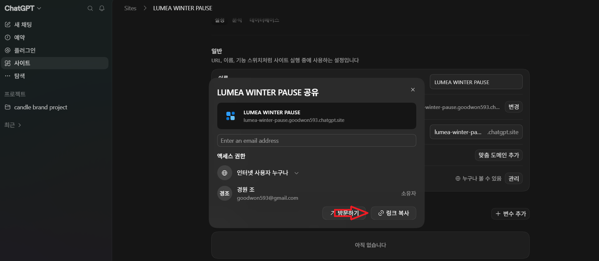

---
> 접속하기 

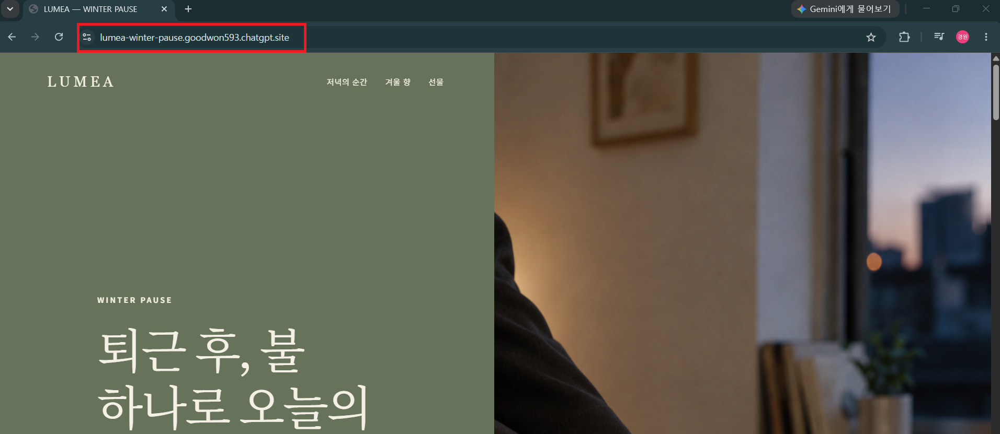

---
### 단계2: 웹사이트 수정하기


