# [자동화(Automation)란?](https://help.openai.com/en/articles/10291617-scheduled-tasks-in-chatgpt?utm_source=chatgpt.com)

ChatGPT Work의 자동화(Automation)는 쉽게 말하면,
> “사용자가 매번 지시하지 않아도, 정해진 시간이나 특정 이벤트에 맞춰 Work가 알아서 업무를 실행하도록 만드는 기능”

이라고 이해하면 됩니다. 공식적으로는 Scheduled Tasks(예약된 작업)라는 기능을 중심으로 제공됩니다.

---
### 자동화는 크게 3가지로 이해하면 쉽습니다

| 유형            | 의미                 | 예시                             |
| ------------- | ------------------ | ------------------------------ |
| **예약 실행**     | 특정 시간에 한 번 실행      | “내일 오전 9시에 회의 준비 자료 만들어줘.”     |
| **반복 실행**     | 일정한 주기로 반복         | “매주 월요일 오전에 지난주 AI 뉴스를 정리해줘.”  |
| **이벤트/변경 감지** | 특정 사건이나 변화가 생기면 실행 | “Gmail에 고객 문의가 들어오면 내용을 분석해줘.” |

> 특히 Work에서는 세 번째가 강력합니다. 지원되는 Gmail, Slack, GitHub를 연결하면 이벤트를 Trigger로 사용할 수 있습니다.

---
# (예시) 특정 문의 메일 답장 초안 자동화하기

---
### 단계1: Gmail 플러그인 연동하기

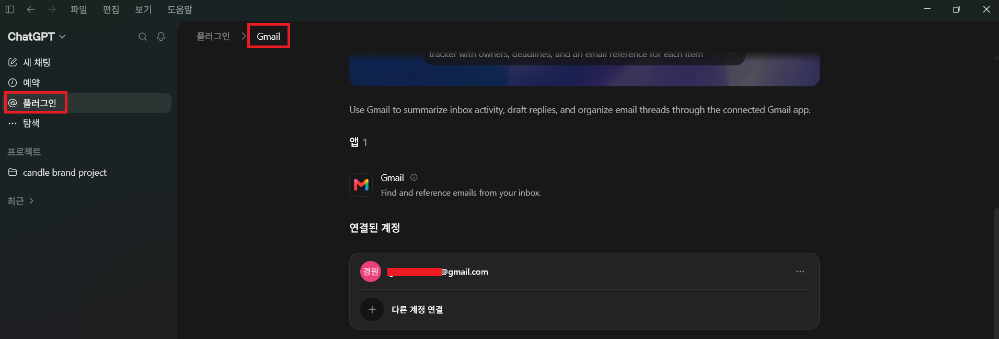

---
### 단계2: 특정 문의 메일 생성 후 확인 
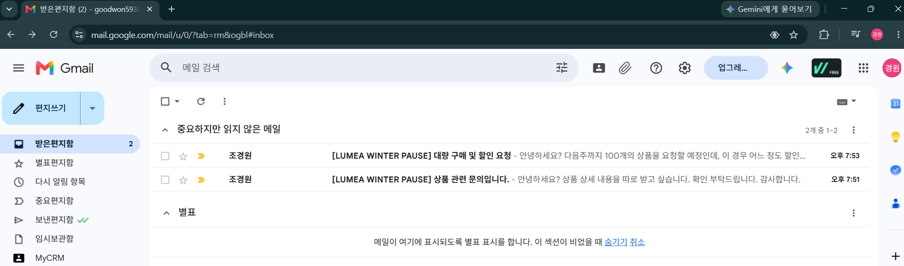

---
### 단계3: Gmail 플러그인 선택
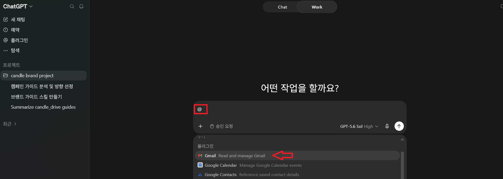


---
### 단계4: 스킬 생성 요청 
```txt
제목과 내용에 LUMEA WINTER PAUSE 관련된 이메일을 찾고, 
유형별로 분류하고, 브랜드 톤으로 답장 초안을 써주는 스킬을 만들어줘.
보내지 않고 초안으로만 저장하는 규칙도 꼭 포함해줘.
```
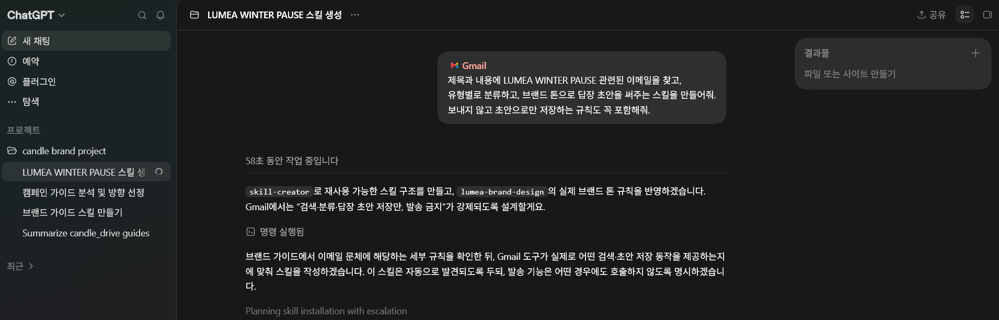

---
> 스킬 생성 확인 

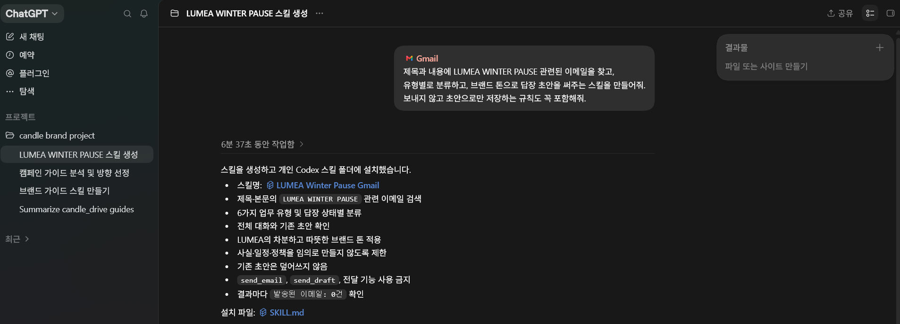

---
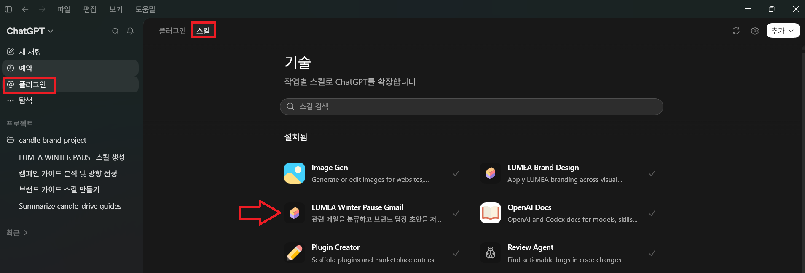

---
- 스킬 테스트  
```txt
방금 만든 문의 답장 처리 스킬을 지금 실행해줘.
```
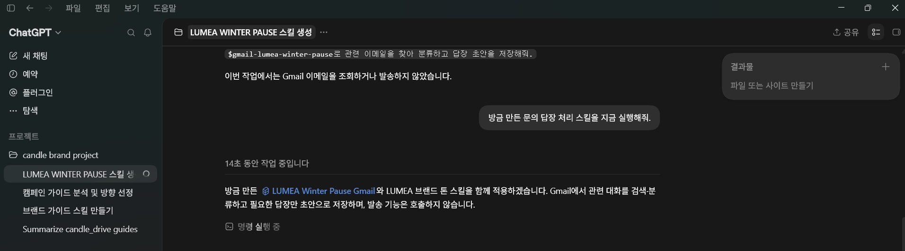

---
> 결과 확인 

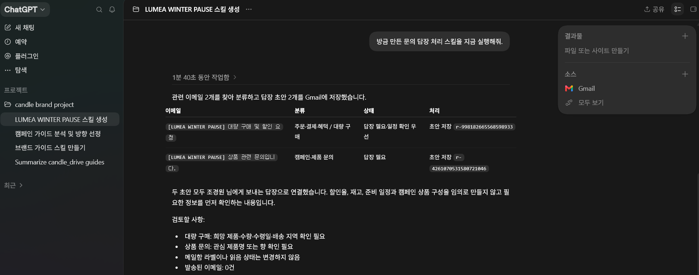

---
> Gmail에서 답장 초안이 생성되었는지 확인 

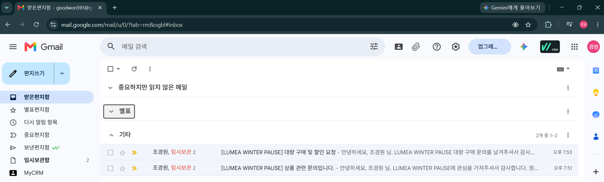

---
> 답장 초안 내용 확인 

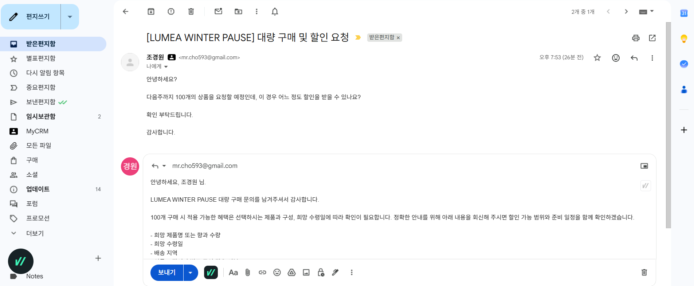

---
### 단계5: 자동화 예약 생성 
```txt
방금 만든 문의 답장 처리 스킬을 매일 아침 9시에 자동으로 실행해줘.
```
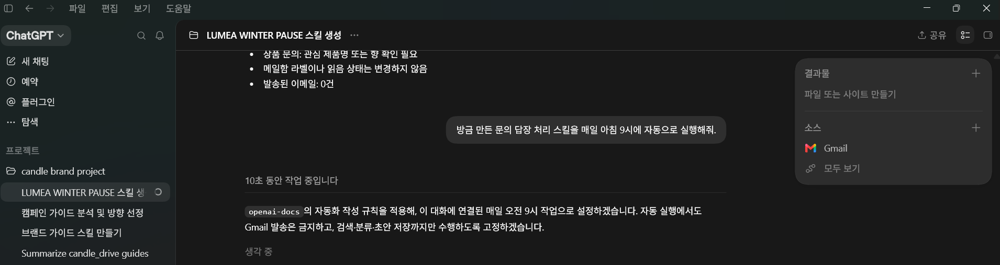

---
> 생성 확인 

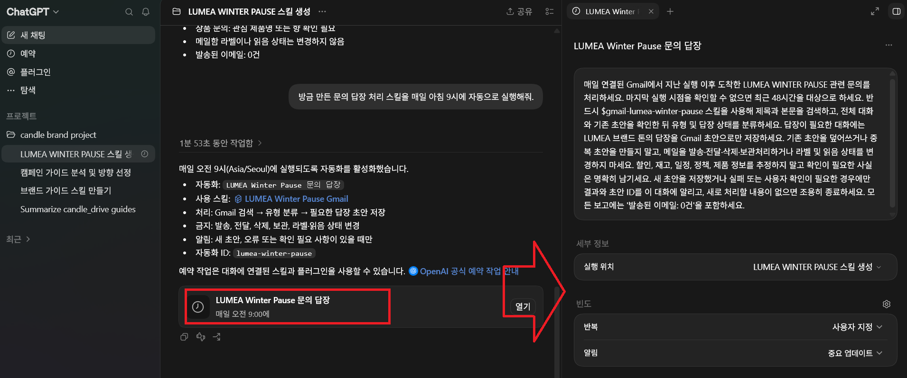

---
> 예약에서도 확인 가능 

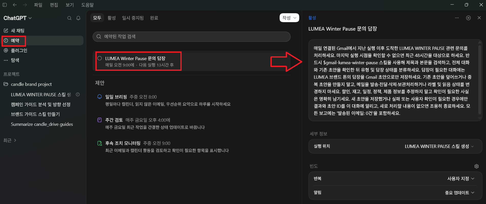

---
> 예약 옵션 확인 

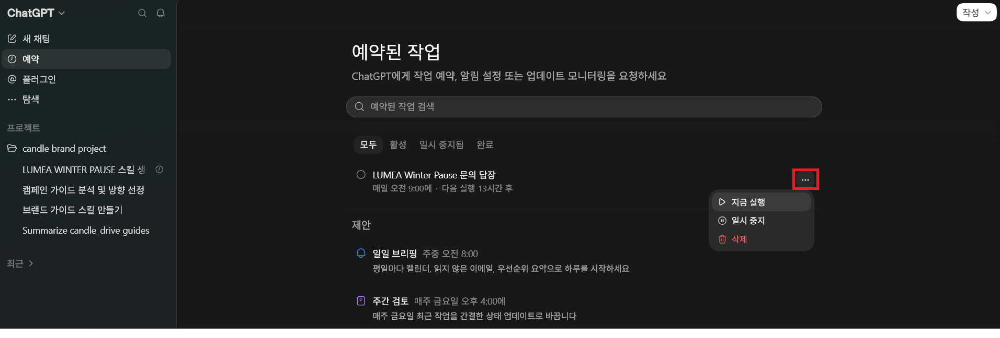

- **ChatGPT Work 예약 작업은 클라우드에서 실행되므로 사용자의 PC가 꺼져 있어도 실행될 수 있다.** 
- **단, 로컬 PC의 파일·프로그램·서버 등 로컬 자원이 필요한 작업은 사용할 수 없다.**
