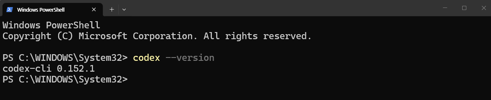
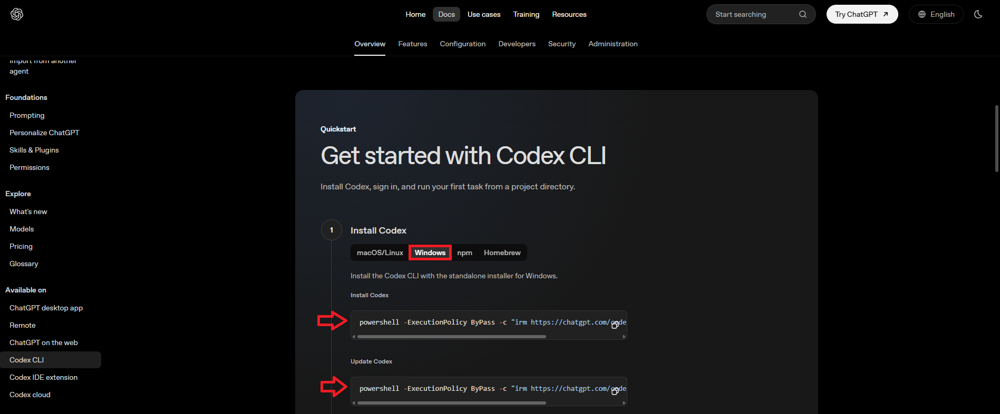
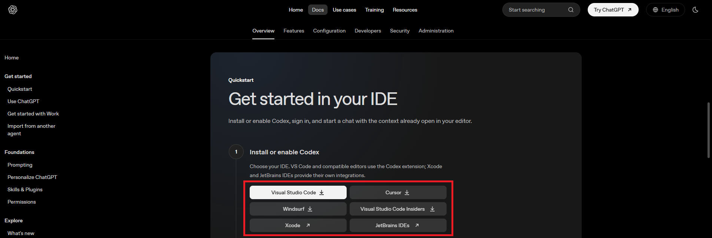
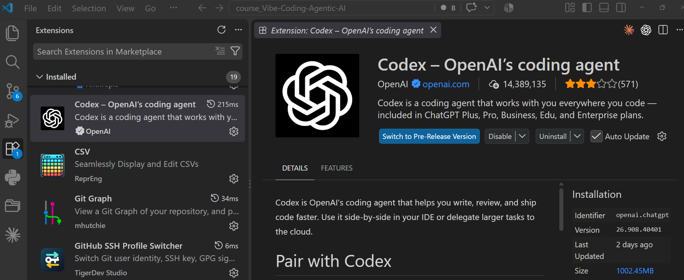

# Codex CLI 설치 확인 
> 설치 버전 확인 
```shell
codex --version
```


---
## [(옵션) Codenx CLI 설치](https://learn.chatgpt.com/docs/codex/cli#getting-started) 



---
## [(옵션) IDE extension 설치](https://learn.chatgpt.com/docs/codex/ide#getting-started)



---
> Visual Studio Code



---
# [The best practices](https://learn.chatgpt.com/guides/best-practices)

---
## 1. Codex는 어떤 도구인가?
> Codex는 단순히 질문에 답하는 챗봇이 아니라, 프로젝트의 파일을 읽고 코드를 작성하며 테스트까지 수행할 수 있는 **AI 코딩 동료**입니다.

---
**좋은 결과를 얻으려면 한 번의 명령으로 모든 것을 해결하려 하기보다 다음 흐름으로 활용하는 것이 좋습니다.**

1. 작업에 필요한 맥락을 제공한다.
2. 복잡한 작업은 먼저 계획한다.
3. 반복되는 규칙은 `AGENTS.md`에 기록한다.
4. 코드를 만든 뒤 테스트하고 변경 내용을 검토한다.
5. 외부 정보는 MCP로 연결한다.
6. 반복 작업은 스킬로 만든다.
7. 안정화된 작업은 예약 실행한다.

---
## 2. 좋은 프롬프트의 4가지 요소

> Codex는 짧은 요청도 처리할 수 있지만, 큰 프로젝트에서는 필요한 정보를 구체적으로 제공할수록 결과가 안정적입니다.

| 요소 | 의미 | 예시 |
| --- | --- | --- |
| 목표(Goal) | 무엇을 만들거나 변경할 것인가? | 회원가입 API를 추가해줘. |
| 맥락(Context) | 어떤 파일·문서·오류가 관련 있는가? | `app/api/users.py`와 기존 로그인 API를 참고해줘. |
| 제약 조건(Constraints) | 반드시 지켜야 할 규칙은 무엇인가? | FastAPI와 Pydantic을 사용하고 기존 응답 형식을 유지해줘. |
| 완료 조건(Done when) | 무엇을 만족하면 작업이 끝나는가? | 회원가입 테스트가 통과하고 중복 이메일은 409를 반환해야 해. |

---
### 좋은 요청(프롬프트)

```text
[목표]
FastAPI 프로젝트에 이메일 기반 회원가입 API를 추가해줘.

[맥락]
- API 파일: app/api/users.py
- 사용자 모델: app/models/user.py
- 기존 로그인 API의 응답 형식을 참고해줘.

[제약 조건]
- 비밀번호는 해시로 저장해줘.
- 기존 함수와 변수의 명명 규칙을 유지해줘.
- 관련 없는 파일은 수정하지 마.

[완료 조건]
- 정상 가입 시 201을 반환한다.
- 중복 이메일이면 409를 반환한다.
- 관련 테스트를 작성하고 모두 통과시킨다.
```

---
### 추론 수준 선택

| 수준 | 적합한 작업 |
| --- | --- |
| Low | 간단하고 범위가 명확한 수정, 오타 수정 |
| Medium / High | 여러 파일 수정, 기능 구현, 디버깅 |
| Extra High | 장시간 진행되는 복잡한 분석 및 에이전트 작업 |

항상 높은 수준이 정답은 아닙니다. 간단한 작업은 낮은 수준이 더 빠르고 효율적일 수 있습니다.

---
## 3. 어려운 작업은 계획부터 세우기

> 요구사항이 모호하거나 여러 단계가 필요한 작업이라면 바로 코드를 작성하게 하기보다 먼저 계획을 요청합니다.

---
### 사용할 수 있는 방법

- **Plan 모드 사용:** `/plan` 또는 `Shift + Tab`으로 전환하여 Codex가 맥락을 조사하고 질문한 뒤 계획을 세우게 합니다.
- **인터뷰 요청:** 아이디어가 막연할 때 Codex가 먼저 질문하도록 합니다.
- **`PLANS.md` 사용:** 규모가 큰 작업에서 계획서의 형식과 실행 절차를 표준화합니다.

---
### 예시

```text
바로 구현하지 말고 먼저 프로젝트 구조를 확인해줘.
불명확한 요구사항은 나에게 질문하고,
수정할 파일·구현 순서·테스트 방법을 포함한 계획을 제시해줘.
내가 계획을 확인한 뒤 구현을 시작해줘.
```

> 핵심: **작업 범위가 클수록 계획에 투자한 시간이 재작업을 줄여줍니다.**

---
## 4. 반복되는 규칙은 `AGENTS.md`에 기록하기

> `AGENTS.md`는 AI 에이전트를 위한 프로젝트 안내서입니다. Codex가 프로젝트에서 작업할 때 자동으로 참고하므로 매번 같은 규칙을 프롬프트에 입력할 필요가 없습니다.

---
### 포함하면 좋은 내용

- 프로젝트 구조와 중요한 폴더
- 프로젝트 실행 방법
- 빌드·테스트·Lint 명령어
- 코딩 규칙과 PR 규칙
- 금지 사항 또는 보안 규칙
- 작업 완료 조건과 검증 방법

---
### 간단한 예시

```markdown
# AGENTS.md

## 프로젝트 구조
- `app/`: 애플리케이션 코드
- `tests/`: 테스트 코드

## 실행 및 검증
- 실행: `uv run fastapi dev app/main.py`
- 테스트: `uv run pytest`
- Lint: `uv run ruff check .`

## 작업 규칙
- 새 기능에는 테스트를 추가한다.
- 환경 변수와 비밀키를 코드에 직접 작성하지 않는다.
- 관련 없는 파일은 수정하지 않는다.

## 완료 조건
- 전체 테스트와 Lint가 통과해야 한다.
- 최종 답변에 변경 파일과 검증 결과를 요약한다.
```

---
### 적용 범위

- `~/.codex/AGENTS.md`: 개인의 전역 기본 규칙
- 프로젝트 루트의 `AGENTS.md`: 팀이 공유하는 프로젝트 규칙
- 하위 폴더의 `AGENTS.md`: 해당 영역에만 적용하는 구체적인 규칙

현재 작업 위치와 가까운 파일의 더 구체적인 지침이 우선합니다. 문서는 길고 추상적으로 쓰기보다 **짧고 정확하게** 유지하는 것이 좋습니다.

---
## 5. 설정으로 일관성 높이기

> Codex의 기본 동작은 `config.toml`에서 설정할 수 있습니다.

| 위치 | 용도 |
| --- | --- |
| `~/.codex/config.toml` | 개인 기본 설정 |
| `.codex/config.toml` | 현재 프로젝트 전용 설정 |
| CLI 옵션 | 한 번만 사용할 임시 설정 |

설정할 수 있는 대표 항목은 모델, 추론 수준, 샌드박스, 승인 정책, 프로필, MCP 서버 등입니다.

---
### 권한 설정 원칙

- 처음에는 기본 권한을 사용합니다.
- 신뢰할 수 있는 프로젝트에서 필요성이 확인됐을 때만 권한을 확대합니다.
- 작업 폴더, 쓰기 권한, 필요한 도구가 올바른지 먼저 확인합니다.
- 비밀번호, API 키, 개인정보가 출력되거나 커밋되지 않게 주의합니다.

> 코딩 품질 문제처럼 보여도 실제 원인은 잘못된 작업 폴더나 실행 환경인 경우가 많습니다.

---
## 6. 구현 후에는 반드시 테스트하고 검토하기

> 코드 생성이 끝났다고 작업이 완료된 것은 아닙니다. Codex에게 다음 과정까지 명시적으로 요청해야 합니다.

- 필요한 테스트 작성 또는 수정
- 관련 테스트 실행
- Lint, 포맷 검사, 타입 검사 실행
- 요구사항과 실제 동작 비교
- 변경 내용(diff)에서 버그와 회귀 가능성 검토

---
### 검증 요청 예시

```text
구현이 끝나면 관련 테스트와 전체 테스트를 실행해줘.
Lint와 타입 검사도 수행하고,
마지막으로 git diff를 검토해서 관련 없는 변경이나 보안 문제가 없는지 확인해줘.
실행한 명령과 결과를 요약해줘.
```

---
### `/review` 활용

`/review` 명령으로 다음과 같은 코드 리뷰를 요청할 수 있습니다.

- 기준 브랜치와 비교하여 PR 형태로 리뷰
- 아직 커밋하지 않은 변경 사항 리뷰
- 특정 커밋 리뷰
- 사용자가 지정한 기준에 따른 리뷰

팀의 리뷰 기준을 `code_review.md`에 작성하고 `AGENTS.md`에서 참조하게 하면 저장소마다 일관된 리뷰를 수행할 수 있습니다.

---
## 7. 외부 정보는 MCP로 연결하기

> MCP(Model Context Protocol)는 Codex를 외부 도구나 시스템과 연결하는 개방형 표준입니다.

---
### MCP가 필요한 경우

- 필요한 정보가 프로젝트 저장소 밖에 있을 때
- 데이터가 자주 변경될 때
- 복사·붙여넣기 대신 실제 도구를 사용하게 하고 싶을 때
- 여러 사용자나 프로젝트에서 같은 연동을 반복해서 사용할 때

---
### 예시

| 외부 시스템 | 활용 예시 |
| --- | --- |
| GitHub | Issue 확인, PR 리뷰 |
| 데이터베이스 | 스키마 조회, 데이터 분석 |
| 문서 도구 | 최신 요구사항이나 회의록 참고 |
| 업무 관리 도구 | 작업 상태 및 담당자 확인 |

처음부터 모든 도구를 연결하지 말고, 반복적인 수작업을 확실히 줄여주는 도구 한두 개부터 추가하는 것이 좋습니다.

---
## 8. 반복 작업은 스킬(Skill)로 만들기

> 스킬은 반복되는 작업 방법을 `SKILL.md`, 관련 자료, 필요 시 스크립트로 묶어 재사용하는 기능입니다.

---
### 스킬로 만들기 좋은 신호

- 같은 프롬프트를 계속 복사해서 사용한다.
- Codex가 같은 실수를 반복하여 계속 수정해줘야 한다.
- 입력과 출력 형식이 일정한 업무가 있다.

---
### 대표적인 활용 사례

- 로그 분석 및 장애 원인 분류
- 릴리스 노트 작성
- 체크리스트 기반 PR 리뷰
- 마이그레이션 계획 작성
- 장애 보고서 요약
- 표준 디버깅 절차

---
### 좋은 스킬의 조건

1. 하나의 명확한 작업에 집중한다.
2. 실제 사용 사례 2~3개로 시작한다.
3. 입력과 출력 형식을 명확하게 정의한다.
4. 설명에 기능과 사용 시점을 함께 작성한다.
5. 처음부터 모든 예외를 처리하려 하지 말고 사용하면서 개선한다.

개인 스킬은 `$HOME/.agents/skills`, 팀 공유 스킬은 저장소의 `.agents/skills`에 둘 수 있습니다. 충분히 검증한 뒤 다른 사람에게 널리 배포하려면 플러그인으로 패키징할 수 있습니다.

---
## 9. 안정적인 반복 업무는 예약 작업으로 실행하기

> 수동으로 여러 번 실행해도 결과가 안정적인 업무라면 예약 작업으로 자동화할 수 있습니다.

---
### 예약하기 좋은 작업

- 최근 커밋 요약
- 잠재적인 버그 점검
- 릴리스 노트 초안 작성
- CI 실패 확인
- 데일리 스탠드업 요약
- 주기적인 분석 보고서 작성

---
### 기억할 공식

> **스킬은 작업 방법을 정의하고, 예약 작업은 실행 시점을 정의합니다.**

아직 사용자의 판단과 수정이 많이 필요한 업무는 먼저 스킬로 안정화한 뒤 예약하는 것이 좋습니다. 예약 작업에서는 프로젝트, 프롬프트, 실행 주기, 실행 환경을 지정합니다.

---
## 10. 장기 작업의 채팅 관리하기

> 채팅에는 작업 맥락과 의사결정이 계속 쌓입니다. 너무 많은 주제를 한 채팅에서 다루면 불필요한 정보가 증가해 결과가 나빠질 수 있습니다.

---
### 주요 명령어

| 명령어 | 용도 |
| --- | --- |
| `/resume` | 저장된 채팅 이어서 작업하기 |
| `/fork` | 현재 맥락을 유지한 채 새 분기로 나누기 |
| `/compact` | 긴 이전 대화를 요약하여 맥락을 정리하기 |
| `/status` | 현재 세션 상태 확인하기 |
| `/apps` | Codex에서 ChatGPT 앱 사용하기 |
| `/agent` | 병렬 에이전트 스레드 사이를 전환하기 |
| `/theme` | 코드 구문 강조 테마 선택하기 |
| `/experimental` | 실험 기능 설정하기 |

---
### 운영 원칙

- 하나의 일관된 작업 목표마다 하나의 채팅을 사용합니다.
- 같은 문제의 연속 작업이면 기존 채팅을 이어갑니다.
- 작업 방향이 실제로 갈라질 때만 `/fork`를 사용합니다.
- 탐색, 테스트, 분류처럼 범위가 명확한 보조 작업은 서브에이전트에 맡길 수 있습니다.

---
## 11. 초보자가 자주 하는 실수

| 실수 | 개선 방법 |
| --- | --- |
| 매번 긴 프롬프트에 공통 규칙을 넣는다. | 지속적인 규칙은 `AGENTS.md`나 스킬로 옮긴다. |
| 실행·테스트 방법을 알려주지 않는다. | 명령어와 완료 조건을 명확히 제공한다. |
| 복잡한 작업을 계획 없이 바로 구현한다. | Plan 모드나 계획 요청을 먼저 사용한다. |
| 처음부터 컴퓨터 전체 권한을 허용한다. | 기본 권한으로 시작하고 필요한 범위만 확대한다. |
| 같은 파일에 여러 작업을 동시에 실행한다. | Git worktree 등으로 작업 공간을 분리한다. |
| 검증되지 않은 업무를 바로 예약한다. | 수동 실행과 스킬로 안정화한 뒤 예약한다. |
| Codex의 모든 단계를 계속 지켜본다. | 목표와 검증 기준을 제공하고 다른 업무와 병행한다. |
| 프로젝트 전체를 하나의 채팅에서 처리한다. | 일관된 결과물 단위로 채팅을 나눈다. |


