# 0. 실습 환경과 기본 프로젝트

## 건강한하루 프로젝트로 배우는 Codex

- 도구: VS Code의 Codex 확장
- 예제: Streamlit + FastAPI + SQLite
- 환경 관리: uv
- 후속 실습: Groq API, 스키마 변경, PostgreSQL 전환

---
## 실습용 Github 저장소 준비 


---
## 프로젝트 코드 확인

> 공통 시작 코드를 실행하고, 변경하기 전의 정상 상태를 확인합니다.

1. 제공된 자료와 코드의 위치를 확인합니다.
2. CSV를 SQLite에 적재합니다.
3. API와 화면을 실행합니다.
4. 기본 테스트를 실행합니다.

완료 기준: 상품 44개 조회, 페이지 이동, 기본 테스트 통과

---
### 단계 1. 기본 프로젝트 열기

```text
healthy-day-codex-lab/
├── docs/       데이터 정의서, 요구사항정의서
├── data/       상품·기능성·섭취기준 CSV
└── project/    학생용 시작 코드
```

터미널의 현재 위치가 `project`인지 확인합니다.
자료를 복사했다면 `docs`, `data`, `project`를 함께 유지합니다.

---
> VS Code에서 `healthy-day-codex-lab/project` 폴더를 엽니다.

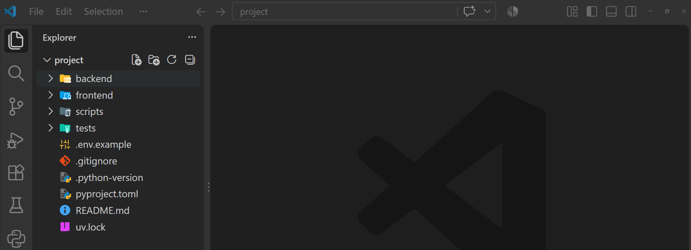

---
### 단계 2. uv로 실행 환경 준비

- Python 3.13과 프로젝트의 의존성을 준비합니다.
- `uv.lock`의 버전으로 설치합니다.
```powershell
# uv가 설치되어 있는지 확인하고 버전을 출력합니다.
uv --version
# uv.lock의 버전대로 .venv에 의존성을 설치합니다.
# --locked: 잠금 파일을 변경하지 않으며, 갱신이 필요하면 오류를 냅니다.
uv sync --locked
```
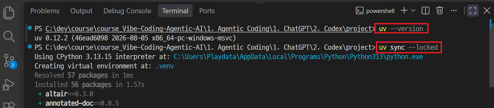

---
- `.env.example`을 복사해서 `.env` 파일 생성합니다.
- 이미 `.env`를 만들었다면 복사 명령은 건너뜁니다.
> 이 단계에는 Groq API 키가 필요하지 않습니다.

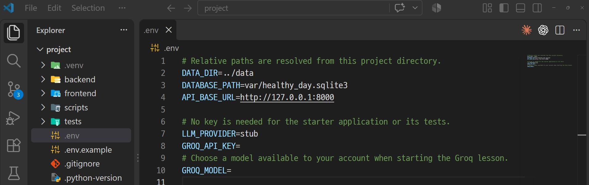

---
### 단계 3. DB에 데이터 적재

> `project/var/healthy_day.sqlite3`가 생성됩니다.
다시 실행해도 기존 레코드는 덮어쓰지 않습니다.
```powershell
# uv run: 프로젝트 가상환경에서 명령을 실행합니다.
# python -m: 지정한 Python 모듈을 실행합니다.
# 초기 스키마를 만들고 CSV 데이터를 SQLite에 적재합니다.
uv run --locked python -m scripts.init_db
```
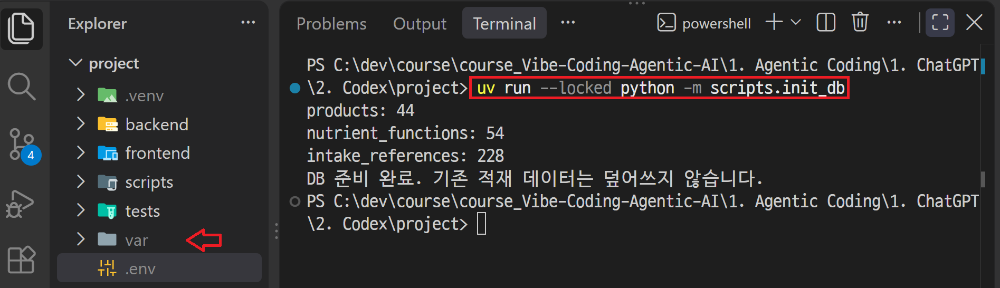

---
### 단계 4. FastAPI 실행

```powershell
# backend.main의 app을 Uvicorn으로 실행합니다.
# --reload: 코드 변경 시 서버를 자동으로 다시 시작합니다.
# --host / --port: 이 컴퓨터의 127.0.0.1:8000에서 접속합니다.
uv run --locked python -m uvicorn backend.main:app --reload --host 127.0.0.1 --port 8000
```
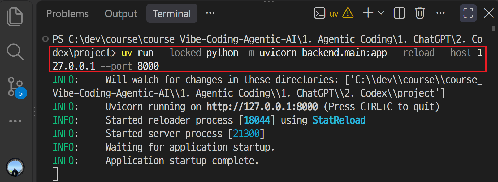

---
> `/health`에서 `status: ok`, `products: 44`를 확인합니다.
- 상태 확인: http://127.0.0.1:8000/health

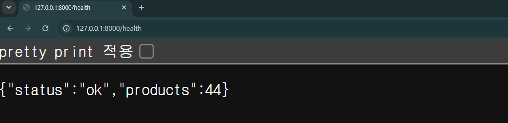

---
- API 문서: http://127.0.0.1:8000/docs

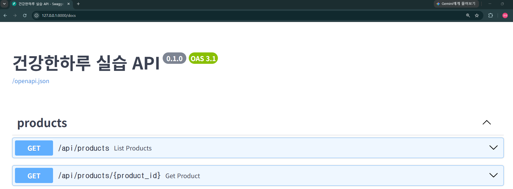

---
### 단계 5. Streamlit 실행

```powershell
# gatherUsageStats false: 사용 통계 수집을 끕니다.
# 줄 끝의 백틱(`)은 명령이 다음 줄로 이어진다는 뜻입니다.
uv run --locked python -m streamlit run frontend/app.py `
  --server.address 127.0.0.1 --server.port 8501 `
  --browser.gatherUsageStats false
```
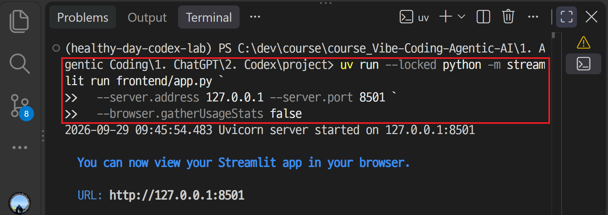

---
http://127.0.0.1:8501 에 접속합니다.

- 전체 상품 수가 44개인지 확인합니다.
- 상품을 펼쳐 상세 정보를 확인합니다.
- 페이지를 3으로 바꾸면 4개가 표시되는지 확인합니다.

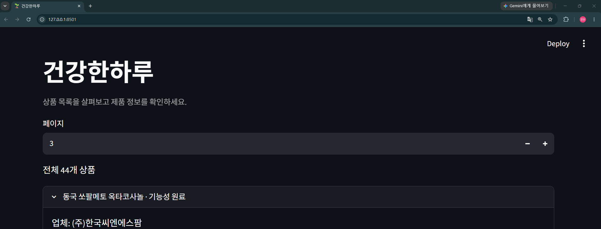

---
### 단계 6. 테스트와 코드 검사
새로운 터미널에서 실행합니다.
```powershell
# 현재 폴더(.)의 코드를 검사하고 오류·미사용 import 등을 보고합니다.
uv run --locked ruff check .
# 파일을 수정하지 않고 코드 서식이 Ruff 기준에 맞는지 검사합니다.
uv run --locked ruff format --check .
```
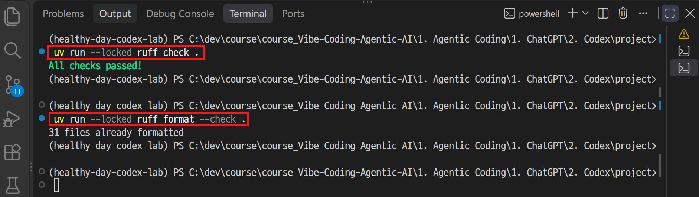

---
```powershell
# pytest로 테스트를 실행합니다. -q는 출력을 간결하게 표시합니다.
# --basetemp: 임시 폴더를 지정해 기본 Temp 폴더의 권한 오류를 피합니다.
# .pytest_cache/tmp는 재실행 시 초기화되므로 테스트 전용으로 사용합니다.
uv run --locked python -m pytest -q --basetemp=.pytest_cache/tmp
```
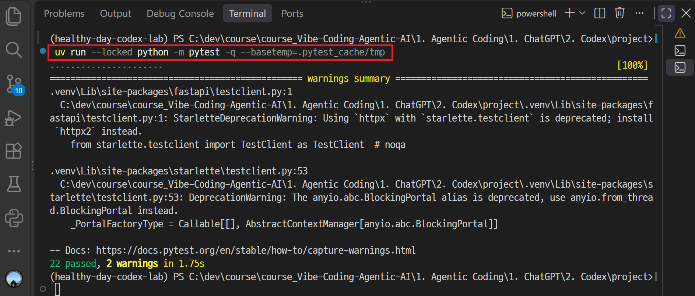

---
### 단계 7. Codex에게 구조 설명 요청

VS Code의 Codex에서 아래 프롬프트를 입력합니다.

```text
현재 프로젝트를 읽고 상품 목록이 화면에 표시되는 과정을 설명해줘.
Streamlit → FastAPI → 서비스 → 저장소 → SQLite 순서로,
각 단계의 실제 파일 경로와 주요 함수를 함께 알려줘.
코드를 수정하지 말고, 실행 방법과 기본 테스트도 확인해줘.
```

---
> 설명에 나온 파일을 직접 열어 실제 코드와 맞는지 확인합니다.

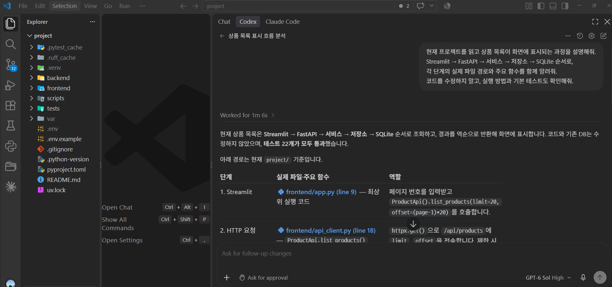

---
#### 코드의 역할 살펴보기

| 위치 | 역할 |
| --- | --- |
| `frontend/` | 화면과 HTTP 호출 |
| `backend/api/`, `schemas/` | API 요청·응답 |
| `backend/services/` | 업무 로직 |
| `backend/repositories/` | SQL 조회 |
| `backend/db/` | DB 연결·초기 스키마·적재 |
| `backend/integrations/` | Groq 연결과 테스트용 대체 구현 |

> 화면에서 DB를 직접 조회하지 않고 API를 거칩니다.
