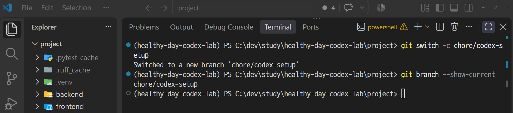
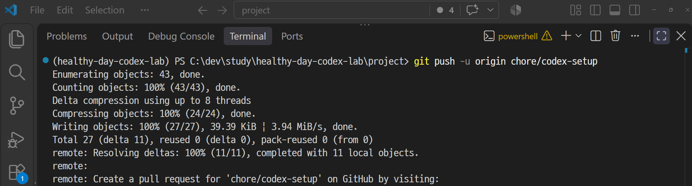
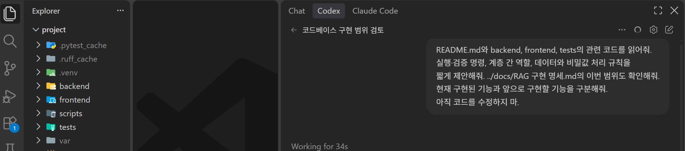
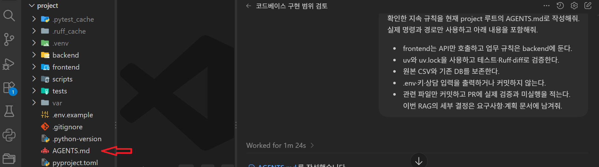
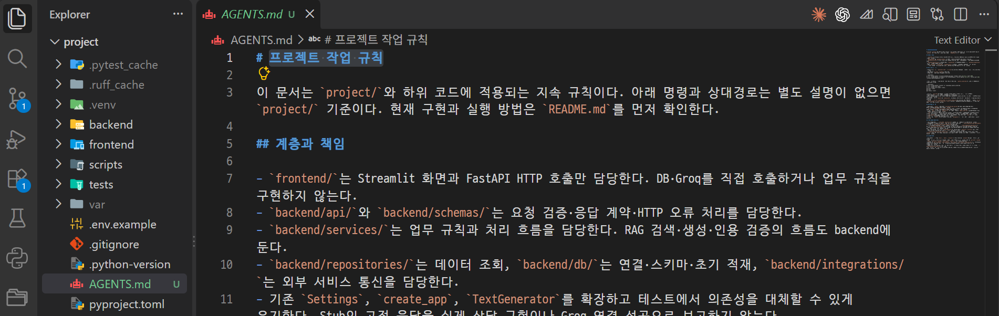
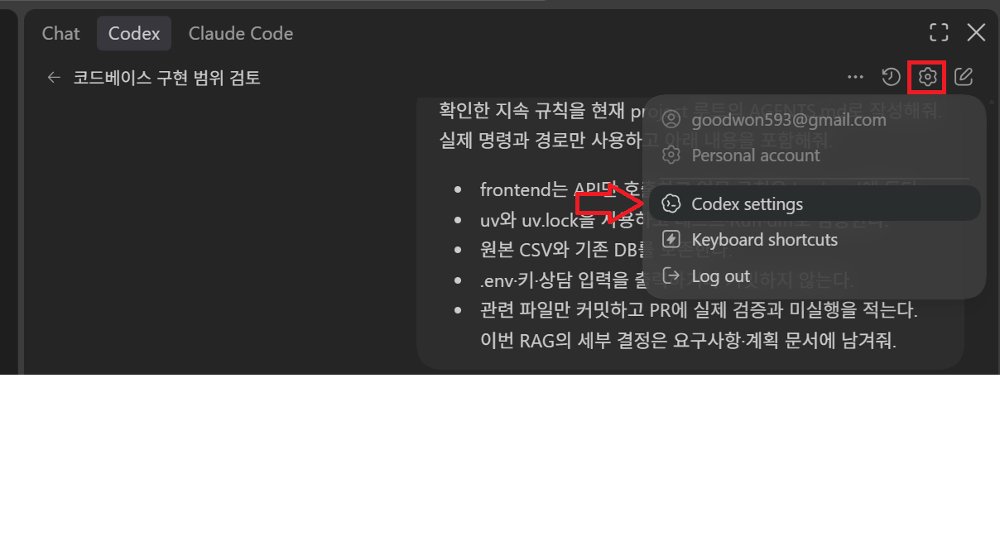
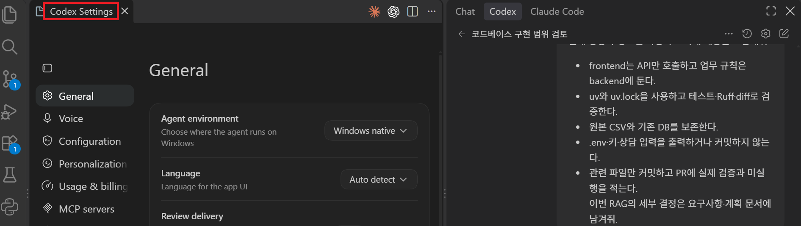
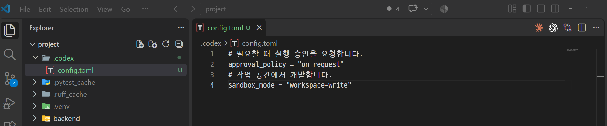
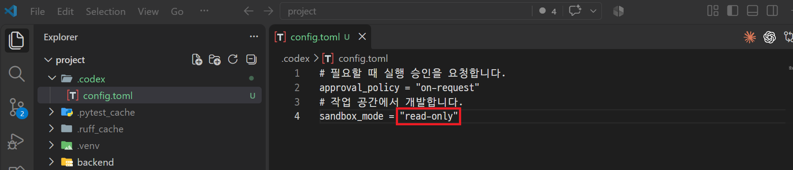
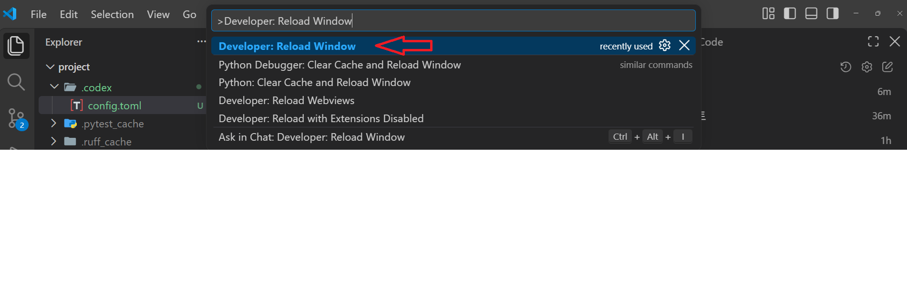

# AGENTS.md와 Codex 설정 적용하기

## 새 작업에서도 같은 규칙으로 개발하기

시작: 1장 상품 조회·화면·기본 테스트 확인

결과: 프로젝트 지침·Codex 설정·적용 확인 기록

---
## 프롬프트 vs AGENTS.md vs config.toml
> `프롬프트`는 ‘오늘 할 일’  
> `AGENTS.md`는 ‘프로젝트 작업 규칙’  
> `config.toml`은 ‘Codex 실행 설정’입니다.

| 구분 | 역할 | 예시 |
|---|---|---|
| `프롬프트` | 이번에 수행할 작업 | “상품 검색 기능을 만들어줘.” |
| `AGENTS.md` | 반복해서 적용할 작업 규칙 | “Python 실행에는 uv를 사용해.” |
| `config.toml` | Codex 실행 환경 설정 | 모델, 추론 수준, 승인 정책, 샌드박스, MCP 연결 |

---
## AGENTS.md 란?
> Codex가 작업하기 전에 읽는 마크다운 형식의 지침 파일입니다. 프로젝트 구조, 실행 명령어, 코딩 규칙, 검증 방법 등을 적어 두면 매번 프롬프트에 반복해서 설명할 필요가 줄어듭니다.

- 좋은 지침은 실제 행동으로 옮길 수 있어야 합니다.

| 모호한 지침 | 구체적인 지침 |
|---|---|
| 코드를 잘 작성해. | 함수와 변수 이름은 snake_case를 사용해. |
| 데이터를 조심해서 다뤄. | `data/raw`의 파일은 수정하지 마. |
| 테스트를 잘해. | 변경한 기능과 관련된 테스트를 실행하고 결과를 설명해. |

---
### AGENTS.md 설정이 여러 곳에 있으면?

| 우선 순서 | 위치 | 역할 |
|---|---|---|
| 1 | 현재 작업 폴더까지의 하위 `AGENTS.md` | 폴더별 세부 지침 |
| 2 | 프로젝트 루트의 `AGENTS.md` | 프로젝트 공통 지침 |
| 3 | `~/.codex/AGENTS.md` | 개인 공통 지침 |

> 상위 폴더는 공통 규칙, 하위 폴더는 세부 규칙입니다. 충돌하면 현재 작업 위치에 더 가까운 규칙이 우선합니다. 같은 폴더에서는 `AGENTS.override.md`가 `AGENTS.md`보다 우선합니다.

---
## Codex 설정이란?
> Codex 설정은 config.toml에 작성합니다. TOML은 설정 이름 = 값 형태로 작성하는 설정 파일 형식입니다.

| 설정 항목 | 의미 |
|---|---|
| `model` | 사용할 모델 |
| `model_reasoning_effort` | 모델의 추론 수준 |
| `approval_policy` | 실행 승인을 요청하는 방식 (언제 실행 허락을 물어볼까?) |
| `sandbox_mode` | 파일·네트워크 접근 범위 (어디까지 접근하고 수정할 수 있을까?) |
| `mcp_servers` | 연결할 MCP 서버 |

---
### Codex 설정이 여러 곳에 있으면?

| 우선순위 | 위치 | 역할 |
|---|---|---|
| 1 | 실행할 때 지정한 CLI 옵션 | 이번 실행에 적용할 설정 지정 |
| 2 | 프로젝트의 `.codex/config.toml` | 해당 프로젝트의 설정 지정 |
| 3 | 개인의 `~/.codex/config.toml` | 여러 프로젝트에서 사용할 개인 기본 설정 지정 |
| 4 | Codex 내장 기본값 | 별도 설정이 없을 때 적용 |

> 프로젝트의 config.toml은 Codex CLI에서만 적용됨! (`VS Code의 Extension에서는 적용되지 않음`)

---
# 이번 실습의 흐름

1. 시작 상태와 설정 브랜치 생성
2. 실제 코드에서 규칙 추출
3. AGENTS.md 작성
4. Codex 설정 적용
5. 변경 검토와 커밋

아직 상담 기능이나 DB 스키마를 변경하지 않습니다.

---
## 단계 1. 설정 브랜치 생성

기본 테스트가 통과하고 시작 코드가 main에 커밋된 상태입니다.

```powershell
# 이번 규칙·설정 작업을 별도 브랜치로 시작합니다.
git switch -c chore/codex-setup
# 현재 브랜치 이름만 확인
git branch --show-current
```


---
### 브랜치를 GitHub에 푸시
- `origin`: 연결된 GitHub 원격 저장소
- `-u`: 로컬 브랜치와 원격 브랜치를 연결
```powershell
# 새 브랜치를 GitHub에 올리고 원격 브랜치와 연결합니다.
git push -u origin chore/codex-setup
```


---
## 단계 2. 실제 코드에서 규칙 추출

Codex 입력창에 요청합니다.

```text
README.md와 backend, frontend, tests의 관련 코드를 읽어줘.
실행·검증 명령, 계층 간 역할, 데이터와 비밀값 처리 규칙을
짧게 제안해줘. ../docs/RAG 구현 명세.md의 이번 범위도 확인해줘.
현재 구현된 기능과 앞으로 구현할 기능을 구분해줘.
아직 코드를 수정하지 마.
```



---

## 단계 3. AGENTS.md 작성

```text
확인한 지속 규칙을 현재 project 루트의 AGENTS.md로 작성해줘.
실제 명령과 경로만 사용하고 아래 내용을 포함해줘.
- frontend는 API만 호출하고 업무 규칙은 backend에 둔다.
- uv와 uv.lock을 사용하고 테스트·Ruff·diff로 검증한다.
- 원본 CSV와 기존 DB를 보존한다.
- .env·키·상담 입력을 출력하거나 커밋하지 않는다.
- 관련 파일만 커밋하고 PR에 실제 검증과 미실행을 적는다.
이번 RAG의 세부 결정은 요구사항·계획 문서에 남겨줘.
```


---
> 생성된 AGENTS.md 내용은 매번 다를 수 있습니다.



---
## 단계 4. Codex 설정 적용
> VS Code Codex 톱니바퀴 → Codex Settings에서 설정 위치를 확인합니다.



---
> Codex Settings 통해 기본 설정 가능 



---
### Codex 프로젝트 설정하기 
> 편집기로 project/.codex/config.toml을 작성합니다.

```toml
# 필요할 때 실행 승인을 요청합니다.
approval_policy = "on-request"
# 작업 공간에서 개발합니다.
sandbox_mode = "workspace-write"
```


---
### 권한과 적용 확인
선택 실험: sandbox_mode를 read-only로 바꾸고 확장을 재시작합니다.



- `Ctrl + Shift + P`=> 재실행



---
> Codex 프로젝트 설정은 Codex CLI에서만 적용됨!
```text
상품 조회의 실행 경로를 조사해줘. 파일을 수정하지 마.
그다음 docs/lab-notes/settings-probe.txt에 확인 문구를 저장해줘.
쓰기 권한이 제한되면 필요한 권한과 이유를 알려줘.
다른 위치로 우회하지 마.
```


---
읽기와 쓰기의 실제 결과를 비교한 뒤 workspace-write로 복귀합니다.
이 실험은 생략할 수 있지만 개발용 설정 복귀는 확인합니다.

---
### 새 채팅에서 테스트를 통해 적용 확인

```text
현재 작업 폴더와 적용 중인 지침 파일 경로를 확인해줘.
이번 프로젝트의 검증·커밋·PR 규칙을 요약해줘.
설정의 실제 적용 여부를 확인할 수 없으면 확인 방법을 알려줘.
비밀값 없이 docs/lab-notes/02-setup.md에 결과를 기록해줘.
```

요약뿐 아니라 다음 작업의 파일 배치·실행 명령도 봅니다.
모델·추론 수준은 현재 클라이언트가 제공하는 값을 확인합니다.

---
## 단계 5. 변경 검토와 커밋

Codex 입력창에서 변경 검토·검증·커밋을 요청합니다.

```text
이번 지침·설정 작업의 변경을 검토하고 커밋해줘.
AGENTS.md의 검증·커밋 규칙을 따라줘.
AGENTS.md, .codex/config.toml, docs/lab-notes/02-setup.md의
내용이 서로 일치하고 개발용 설정으로 복귀했는지 확인해줘.
비밀값과 불필요한 파일을 제외하고 이번 변경만 stage해줘.
staged diff와 git diff --cached --check 결과를 확인하고,
검증을 통과하면 chore: configure Codex project rules로 커밋해줘.
변경 파일, 검증 결과·미실행 항목, 커밋 해시를 알려줘.
```

설정 실험 파일은 실제 남겼을 때만 별도로 포함합니다.

---
### 사람이 Git 명령어로 결과 확인

AI의 완료 보고를 받은 뒤 project 터미널에서 직접 확인합니다.

```powershell
# 현재 브랜치와 남은 변경을 확인합니다.
git status --short --branch
# 최근 커밋 해시·메시지·변경 파일을 확인합니다.
git log -1 --format=fuller --stat
# 실제 커밋 내용과 공백·충돌 마커 오류를 확인합니다.
git show --format= --patch HEAD
git show --format= --check HEAD
```

- 브랜치가 `chore/codex-setup`이고 커밋 해시·메시지가 AI 보고와 같은지 봅니다.
- 커밋에 이번 지침·설정·기록만 포함되고 내용이 의도에 맞는지 봅니다.
- 이번 작업의 미커밋 변경과 `--check` 오류 출력이 없는지 확인합니다.
- 차이가 있으면 해당 Git 출력을 AI에게 전달해 원인 확인과 수정을 요청합니다.
