# [Install Codex CLI](https://learn.chatgpt.com/docs/codex/cli#getting-started)

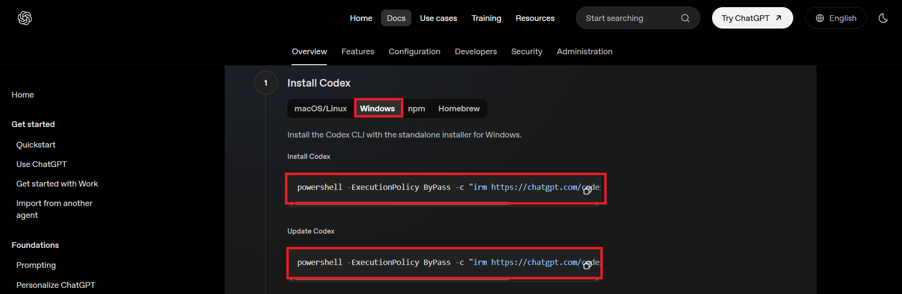

---
### Install Codex

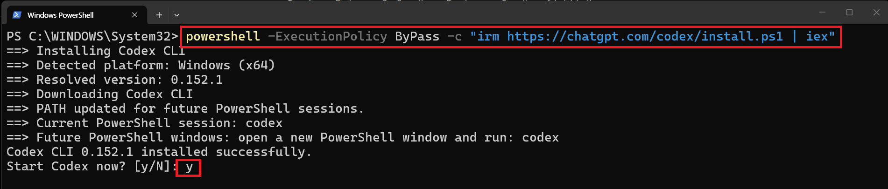

---
> 최초인 경우, 로그인 진행 > Enter 

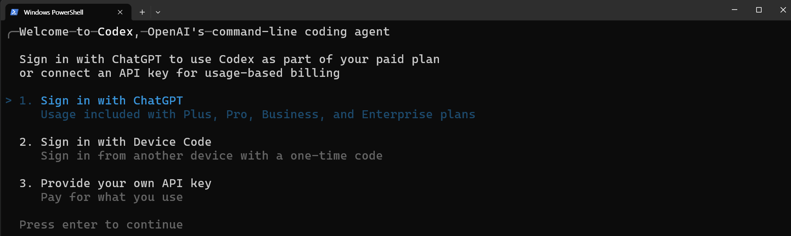

---
> 최초 안내 메세지 > Enter

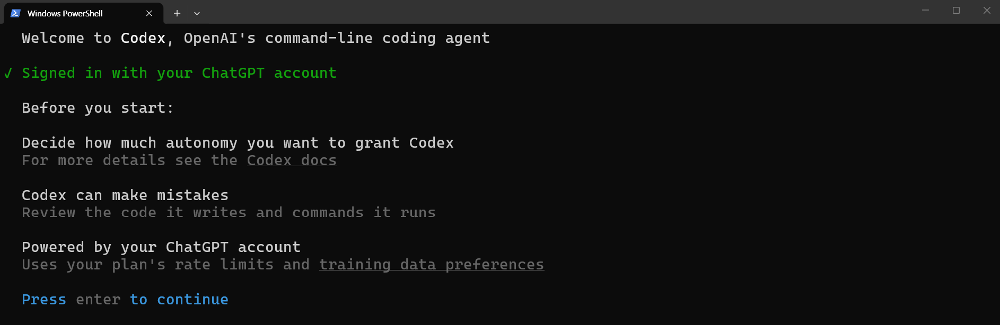

---
> 종료 > Enter 

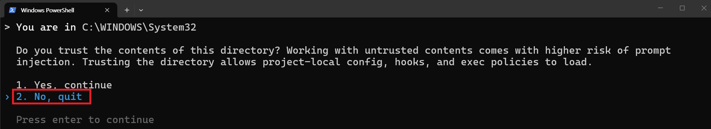

---
> 새로운 PowerChell 실행
```shell
# 개발 전용 폴더로 이동 
cd C:\dev

# codex 설정 다시 시작 
codex
```
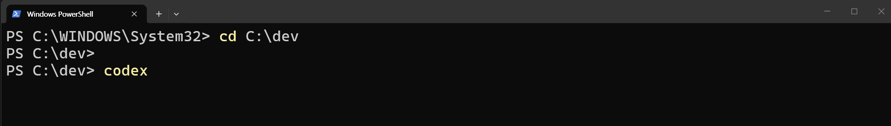

---
> codex에 개발전용 폴더 설정

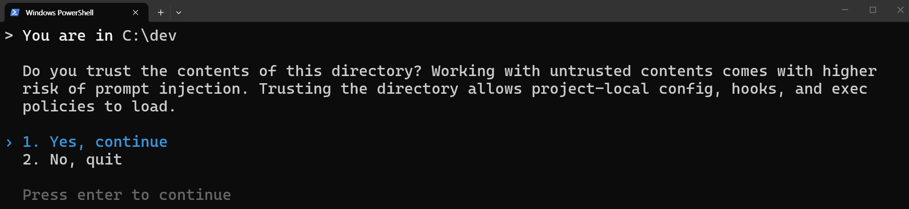

---
> 결과 확인 


---
> 종료: `Ctrl + C`

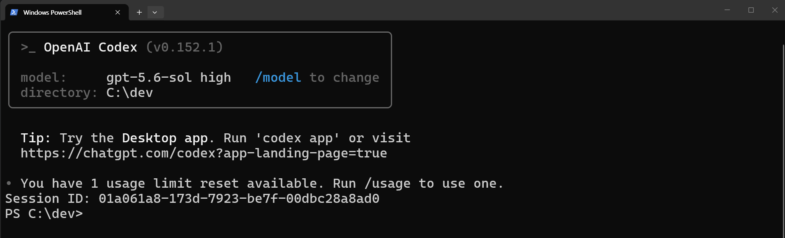

---
### Update Codex

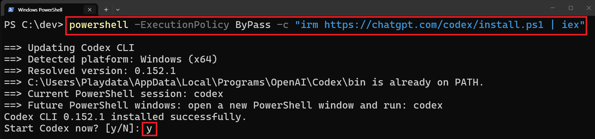

---
> 결과 확인

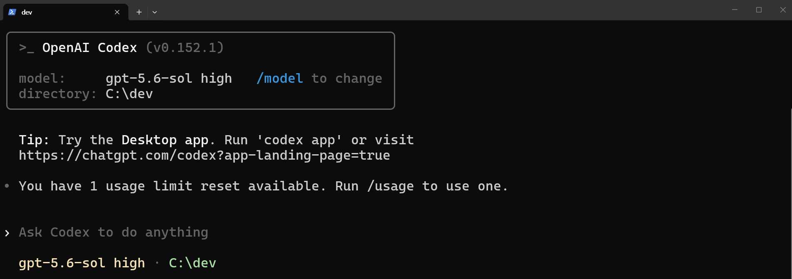

---
# [Codex CLI 명령어](https://learn.chatgpt.com/docs/developer-commands?surface=cli) 

---
| 구분            | 확인 방법          | 의미                 |
| ------------- | -------------- | ------------------ |
| CLI 명령/옵션     | `codex --help` | Codex 실행 방법과 옵션    |
| Slash Command | `/`            | Codex 실행 중 사용하는 명령 |
| 모델 변경         | `/model`       | 모델/추론 수준 변경        |
| 상태 확인         | `/status`      | 현재 세션 설정 확인        |
| 코드 리뷰         | `/review`      | 코드 변경사항 리뷰         |
| 사용량           | `/usage`       | 사용량/한도 확인          |


---
### Codex 실행 방법과 옵션
```shell
codex --help
```
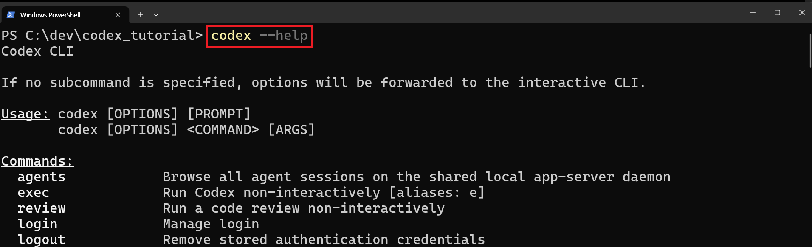

---
### Codex 실행 중 사용하는 명령
```shell
/
```

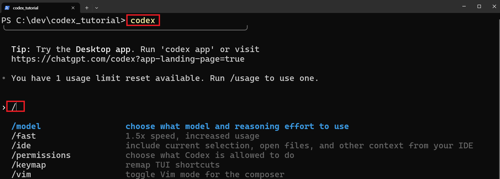

---
### 모델/추론 수준 변경
```shell
/model
```
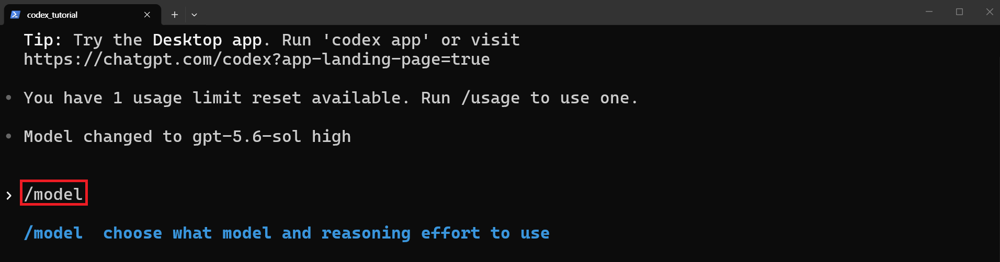

---
> 모델 선택 

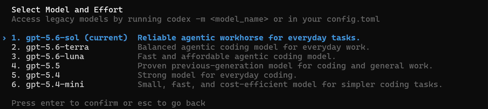

> 추론 선택 

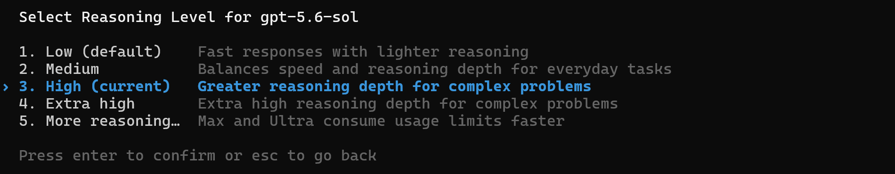

---
### 현재 세션 설정 확인
```shell
/status
```
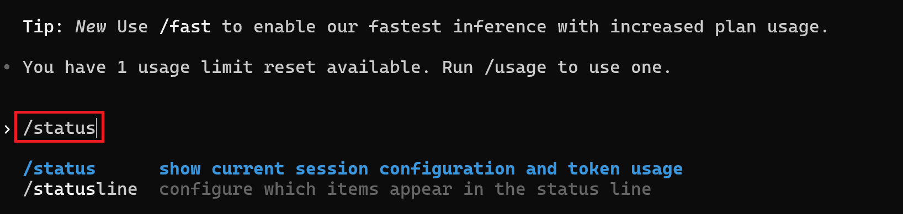

---
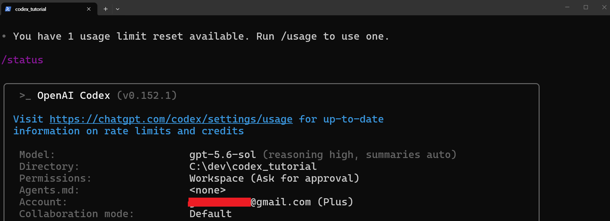

